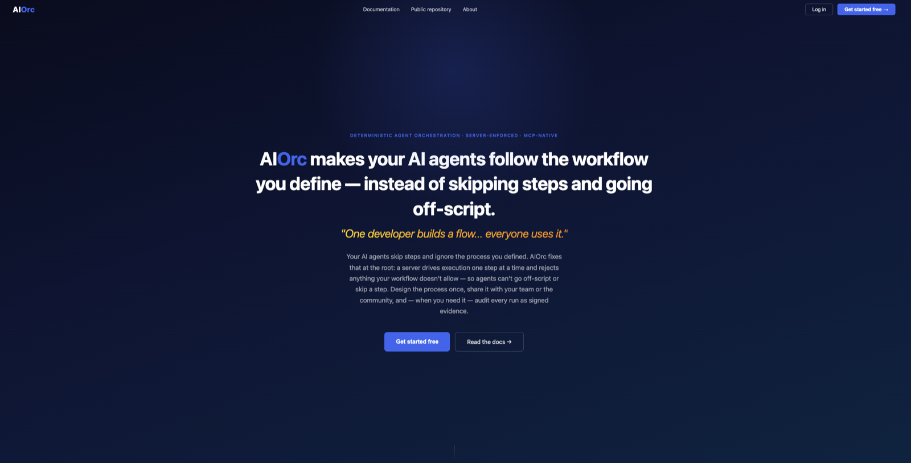
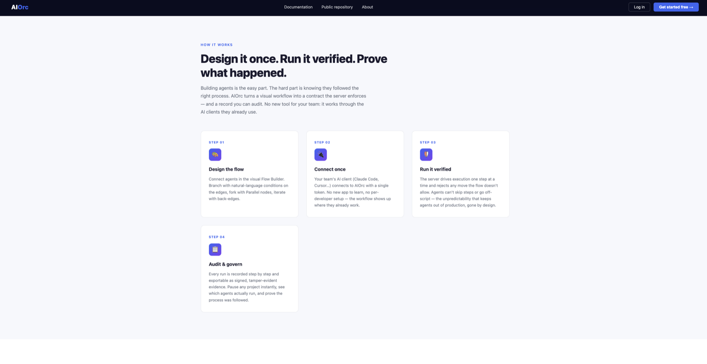
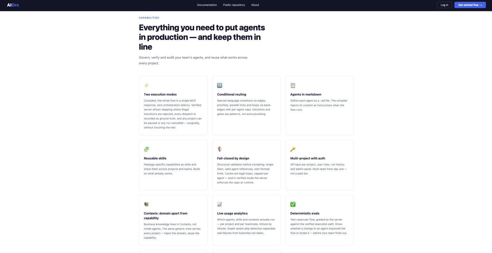
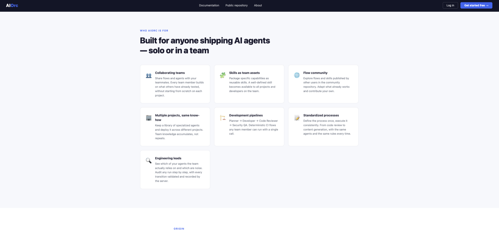

# AIOrc

**The control plane for a company's AI agents. The server enforces your workflow graph instead of suggesting it to the model: every step must hand back an output that matches its schema, the server decides each transition, and every run exports as signed, hash-chained evidence.**

[](https://github.com/Dich01/aiorc/actions/workflows/ci.yml)
[](LICENSE)

**This project is open to collaborators.** It is early stage and looking for people to build it with, not only to use it. Every open issue is scoped so you can start without asking first, and several are tagged [`good first issue`](https://github.com/Dich01/aiorc/issues?q=is%3Aopen+label%3A%22good+first+issue%22). See [Contributing](#contributing).

### Live demo

**There is an instance running right now at [204-216-144-224.sslip.io](https://204-216-144-224.sslip.io)**. The landing page is open to anyone. Accounts are created by its administrator unless the instance runs with open registration.



AIOrc is the **control plane for a company's AI agents**: a multi-tenant registry that stores, shares, governs and *measures* agents — and exposes each project's workflow to any MCP-compatible LLM client (Claude Code, Cursor, or anything that speaks MCP) with **server-verified execution**. The orchestration graph is enforced by the server, not just suggested to the model; any project can be paused instantly (kill switch), any in-flight run cancelled surgically, and every run exported as a signed, tamper-evident audit trail.

## Why

When a company adopts AI seriously, prompts and agents scatter across repos, notes and people's heads. Nobody knows which agents exist, which ones actually work, or which ones the LLM silently skips mid-workflow. AIOrc answers all three:

- **Registry**: agents, skills (reusable guardrails) and contexts (business knowledge), organized per project, shareable across users with invitations, stars, forks and issues.
- **Verified orchestration**: the server hands the model **one step at a time**. Each agent declares an output schema; a step counts as completed only when its output validates. Rule edges are evaluated by the server on that output; natural-language edges are chosen by exact edge id. Invocation caps, fork joins and step numbers are enforced, and a run only completes at an End node.
- **Usage analytics**: live dashboards of which agents, skills, projects and contexts actually complete steps, and who runs them.
- **Evals**: test cases per flow, graded from the run's event chain: the exact End reached, the agents that completed a step, and field-by-field matches on the final findings. The model never grades its own work.
- **Harnesses as files**: a whole review setup (agents, skills, contexts, flows, evals) lives in a directory, is validated by the server's own validators and applied with one command, so changes go through pull requests.
- **Admin panel**: platform KPIs, adoption funnel, per-user activity, top projects, community engagement and system health.

## Features

| | |
|---|---|
| Multi-tenant projects | Private (API-key) or public, with per-project agent/skill/context libraries |
| Agents, Skills, Contexts | Multi-file markdown entities with an output schema per agent; frozen per run when it starts |
| Visual flow editor | Start / Agent / Parallel / End nodes, natural-language edge conditions, loops via back-edges; rule edges round-trip and show read-only |
| MCP server | `workflow.start`, `workflow.next`, `workflow.eval` over JSON-RPC 2.0 (contract v2) |
| Verified execution | Outputs validated per step, server-decided transitions, real fork joins, idempotent retries |
| Kill switch & cancel | Pause a project (blocks new runs; in-flight runs finish) or cancel a single run without touching anything else |
| Signed audit trails | Append-only, hash-chained event log per run; exports signed with Ed25519 and verifiable offline |
| Evals | Per-project test cases graded from the event chain, including expected findings for seeded-bug PRs |
| Review runners | A pre-PR script and git hook, and a GitHub Actions template that publishes an advisory check |
| Usage analytics | Live chart (1m to all-time ranges), breakdowns by agent/project/skill/context, per-user attribution, run detail with every step and output |
| Admin panel | Users, KPIs, adoption funnel, signups, top projects, community and system health (admin role only) |
| Community layer | Stars, forks, invitations, issues with voting — an internal app store for your company's agents |

## How it compares

Dify and n8n put multi-team workspaces, granular permissions, audit trails and self-hosting behind an Enterprise plan. Here they are in the MIT-licensed core, with no seat count and no paid tier.

The larger difference is architectural. Those tools, and agent frameworks like LangGraph and CrewAI, hand the model a workflow and trust it to follow along. AIOrc drives execution from the server: it releases one step at a time, refuses to advance until the step's output validates, decides the transition itself, enforces per-agent invocation caps, and writes each event to a hash chain. "The agent skipped a step" stops being something you discover afterwards from a self-reported log, because the skip is refused while it is being attempted.

## Screenshots

**Design once, run verified, prove what happened** — the four stages of a flow's life.



**What you get** — execution modes, conditional routing, reusable skills, live analytics and deterministic evals.



**Who it's for** — from a solo developer shipping agents to a team standardizing its process.



## Quickstart

```bash
npm install
npm run build:flow   # build the React Flow editor bundle
AIORC_ADMIN_EMAIL=you@example.com AIORC_ADMIN_PASSWORD='at-least-12-chars' npm run admin:create
npm run harness:apply -- harnesses/code-review   # optional: load the reference review harness
npm run dev          # API + UI on http://localhost:3001
npm test             # unit and integration tests
```

A new database has no users: there is no seed. `admin:create` creates the
first admin (in a container: `node dist/scripts/adminCreate.js`).
Registration is closed unless `AIORC_OPEN_REGISTRATION=1`; admins create
accounts in the meantime (`POST /admin/users`).

The database has a schema version. A build that needs another version refuses
to start; `AIORC_DB_RESET=1` moves the old file aside as `*.bak` and starts
empty. There are no in-place migrations.

### Environment

| Variable | Purpose |
|---|---|
| `PORT` | HTTP port (default 3001) |
| `AIORC_DB_PATH` | SQLite file (default `data/aiorc.db`) |
| `AIORC_DB_RESET=1` | Move a database at another schema version aside and start empty |
| `JWT_SECRET` | Session signing secret (otherwise `.jwt-secret`, generated on first start) |
| `AUDIT_PRIVATE_KEY` / `AUDIT_KEY_FILE` | Ed25519 audit signing key (otherwise `.audit-ed25519.key`, generated with mode 0600) |
| `AIORC_OPEN_REGISTRATION=1` | Allow self-service sign-up |
| `AIORC_TRUST_PROXY` | Express `trust proxy` setting (default: loopback and private networks) |
| `AIORC_GATEWAY_ALLOW_PRIVATE=1` | Let registered external MCP servers live on private addresses |
| `AIORC_ADMIN_EMAIL`, `AIORC_ADMIN_PASSWORD` | Used by `npm run admin:create` |

### Connect an MCP client

Claude Code can connect over HTTP directly:

```bash
claude mcp add --transport http aiorc https://aiorc.example.com/mcp \
  --header "x-project-key: aiorc_pk_..." --header "Authorization: Bearer aiorc_pat_..."
```

Clients that only speak stdio can use `mcp-bridge.js` (`AIORC_URL`,
`AIORC_PROJECT_KEY`, optional `AIORC_TOKEN`). The project key is shown once,
when the project is created or its key is reset; only a hash is stored. The
personal access token (`Authorization: Bearer aiorc_pat_...`, created at
`POST /users/me/tokens`) is optional and makes the run's caller a verified
identity. `x-user-email` is still accepted but recorded as a declared,
unverified caller.

### MCP contract v2

1. `workflow.start {request | input, evalCase?}` validates the flow and the
   input (against the project's input schema, if it has one), freezes a
   snapshot of every agent, skill and context the flow uses, and returns
   step 1 with the JSON Schema each output must satisfy.
2. `workflow.next {runId, step, outputs: [{node, output}], transition?}`
   hands back one output per dispatched agent. Each is validated; anything
   missing or invalid is rejected and the step stays open. The server picks
   the next step from rule edges; for natural-language exits the client
   sends the exact edge id it chose. Resending the same call returns the
   same answer; a call with another step number is refused.
3. Repeat until the run reaches an End (`completed`). Other endings are
   `capped`, `cancelled`, `abandoned` and `failed`.

External MCP servers registered in a project are proxied through the same
connection, only during an active run (`params._meta.runId`) and only for
tools the dispatched agent lists in `allowed_tools`.

### What the server guarantees, and what it does not

It guarantees the order of steps, that each completed step handed back an
output of the declared shape, that transitions follow the graph (decided by
the server for rule edges), that a run is executed from the instructions it
started with, and that its history cannot be edited without breaking the
hash chain and the signature.

It cannot guarantee that the model did the work well: a schema-valid output
can still be wrong. That is what evals with seeded bugs measure, and why
findings go through a verifier step and stay advisory.

### Verify an export

```bash
curl -s https://aiorc.example.com/audit/keys          # public key (kid + PEM)
npm run audit:verify -- export.json --key public.pem  # offline, no server needed
```

`POST /audit/verify` does the same on the server. Verification recomputes
the event chain, checks every output and the manifest of frozen entities
against it, and checks the Ed25519 signature.

### Harnesses and runners

- `harnesses/code-review/`: reference harness with two projects,
  `code-review-pre-pr` and `code-review-post-pr`. Prompts are skeletons; the
  structure (schemas, rules, fork, verifier, evals) is complete.
- `runners/`: the pre-PR script and hook, and the GitHub Actions template.
  See [runners/README.md](runners/README.md).

## Architecture

- **Backend**: Express + TypeScript + better-sqlite3 (WAL). No LLM dependency: the consuming model executes; AIOrc is the contract and the auditor.
- **Engine**: `src/orchestrator/` (persistence and prompts) and `src/shared/flow.ts` (graph model, rules and validation, shared with the editor).
- **Audit**: `run_events` (append-only, hash-chained), `run_snapshots`, `run_step_outputs`; Ed25519-signed exports.
- **Frontend**: vanilla HTML/JS pages + a React Flow editor bundle (Vite).

## Status

Early stage (v0.1), used in production internally. SQLite-backed, single-node. Postgres support and broader test coverage are on the roadmap.

## Contributing

**The project is open to collaborators and actively wants them.** It is early stage with one maintainer so far, which means there is room to own an area rather than send a one-off patch. If you want to take something on, say so in the issue and it is yours.

See [CONTRIBUTING.md](CONTRIBUTING.md) for setup, project layout and conventions — the short version is `npm install && npm test` (unit and integration tests, no framework), branch off `development`, and never commit anything under `data/`.

Where to start:

- [`good first issue`](https://github.com/Dich01/aiorc/issues?q=is%3Aopen+label%3A%22good+first+issue%22) — genuinely small and self-contained: a route test, a documentation section.
- [`help wanted`](https://github.com/Dich01/aiorc/issues?q=is%3Aopen+label%3A%22help+wanted%22) — the heavier pieces: a Postgres adapter behind the db layer, engine transition coverage, retry semantics in the MCP bridge.
- [Open design questions](https://github.com/Dich01/aiorc/issues?q=is%3Aopen+label%3Aquestion) are unresolved on purpose. An opinion there is worth as much as code, and it is the fastest way to shape where this goes.
- [Discussions](https://github.com/Dich01/aiorc/discussions) for usage questions, so the issue tracker stays for work.

Every issue states what to change, which file and line, and how to verify it.

For security vulnerabilities, please use private reporting rather than a public issue — see [SECURITY.md](SECURITY.md).

## License

[MIT](LICENSE) — Copyright (c) 2026 Diego Cheloni.
